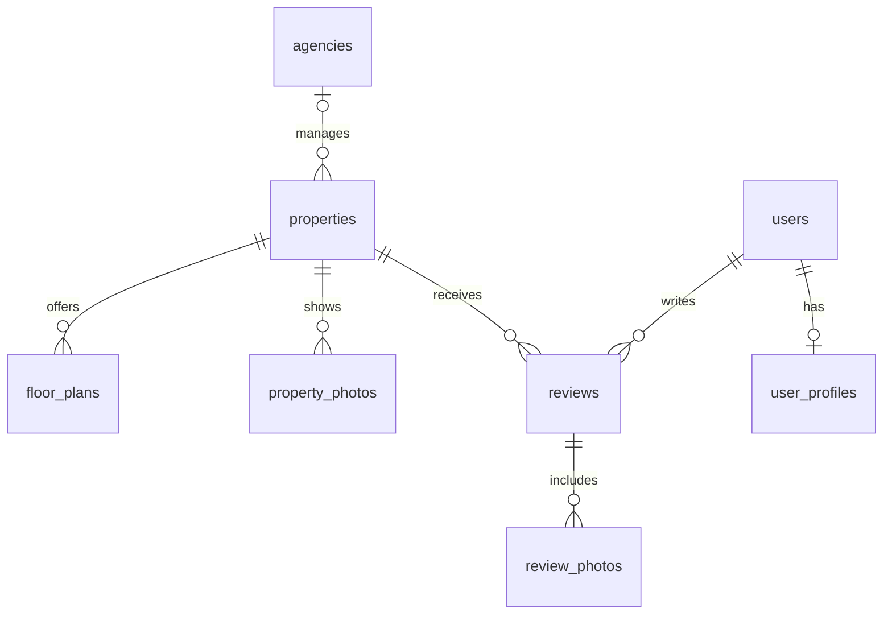

# Mountaineer Housing Hub - Backend

The backend uses TypeScript, Express, MySQL (`mysql2`), and Better Auth.
Redis and object storage are configured separately for the application.

## Connect MySQL and Redis

Copy `example.env` to `.env` and replace the MySQL and Redis placeholders with
the credentials from the services you created. Keep `.env` local; it is ignored
by Git. Redis URLs must use one of these forms:

```text
redis://:PASSWORD@HOST:PORT
rediss://:PASSWORD@HOST:PORT
```

Use `rediss://` when the provider requires TLS. Percent-encode reserved
characters in usernames and passwords when placing them in a URL.

Check both services without starting OAuth or object storage:

```powershell
npm run check:services
```

The command only pings the two services and counts tables in the configured
database. If MySQL says the host is not allowed, grant the configured database
user access from the backend host (or the provider's recommended network range)
instead of using a globally privileged user. If it reports zero tables, run the
schema bootstrap below.

For a brand-new MySQL or MariaDB server/database, the repository can perform the
bootstrap:

```powershell
npm run db:setup
```

The setup reads database values from `.env`, confirms the server is MySQL 8.0.16+
or MariaDB 10.6+, creates the configured database when absent, and loads every
schema file in order. It refuses to run if the database contains any tables. If
the normal application user cannot create databases, set `DB_SETUP_USERNAME`
and `DB_SETUP_PASSWORD` locally to a temporary administrator account; these
values must never be committed.

Sign-in is Google OAuth only, restricted to verified `@appstate.edu` addresses.
The Google provider requires the `appstate.edu` hosted-domain claim, and the
server validates the exact email domain for new users, account linking, and
returning sign-ins. Email/password authentication is explicitly disabled.
Google supplies email verification; no separate verification email is sent.

Keep the `verification` table: Better Auth's current database-backed OAuth flow
stores temporary state/PKCE information there, and the configured `oneTimeToken`
plugin also uses it. The table name does not mean users must verify their email
again. See [Better Auth's state storage documentation](https://better-auth.com/docs/reference/options).

## Local Google sign-in

In your Google Cloud project's OAuth client configuration, use a **Web application**
client and register this exact authorized redirect URI:

```text
http://localhost:3001/auth/callback/google
```

Use `http://localhost:3000` as the authorized JavaScript origin. Configure the OAuth
consent screen and, if the app is in testing, add the App State accounts that will
test sign-in. Put the client credentials in the backend's local `.env`:

```dotenv
GOOGLE_CLIENT_ID=your-client-id
GOOGLE_CLIENT_SECRET=your-client-secret
FRONTEND_URL=http://localhost:3000
BETTER_AUTH_URL=http://localhost:3001
PORT=3001
```

Also supply the existing database, Redis, object storage, and Better Auth secret
settings from `example.env`. Start the backend with `npm run dev`, then start the
frontend on port 3000. Use the same `localhost` hostname for both services.
Visit `/auth/login` and sign in with a verified `@appstate.edu` Google account.
Successful sign-in returns to the home page and shows **Sign out** in navigation.
The Google callback is handled by the backend; it is not a frontend page.

See [Better Auth Google setup](https://better-auth.com/docs/authentication/google).

## Database design

### Accounts, favorites, and staff access

### Property and rental agency suggestions

### Public property API

The homepage, directory, search results, property detail pages, and map now read
published database listings from `GET /properties` and `GET /properties/:slug`.
The list accepts `q` (property name, agency, address, or description) and `limit`
(up to 500). The homepage shows the six most recently updated published listings.
Only published reviews contribute to public ratings.

Add property photos to `property_photos` and floor plans to `floor_plans`.
Missing photos/prices show honest placeholders. Prices per unit and per bedroom
are displayed separately. Add latitude and longitude to place a property on the
map. Draft and archived properties are excluded from public pages, and properties
with no coordinates remain in the directory but have no map marker.

No schema changes or example records are needed for this API. The old frontend
demo file remains available to the opt-in development seed script, but public
pages no longer use it as a fallback. Agency catalog pages are still placeholders.

### Suggestion submission flow

`/submit` is for apartment/property reviews. Missing-property suggestions live
at `/submit/apartment`, which can suggest either a residential property or a
rental agency. Properties have a type and residential address, and may link to
an existing managing agency, propose a new managing agency, or leave it unknown.
Agency-only suggestions do not require a residential address. Reviews remain
attached to properties, with the managing agency shown in the property selector.

After migration 001, run `src/db/migrations/002_property_and_agency_submissions.sql`
once in phpMyAdmin for an existing database. `npm run db:accounts` also applies
these additions when needed. Fresh bootstraps already include the new fields.
Migration 002 only changes the schema; it inserts no example agencies or properties.

The staff apartment queue displays the suggestion kind, property type, and
existing or proposed managing agency. Approval accepts a proposal for catalog
preparation, preserving the distinction between `agencies` and `properties`;
it does not automatically publish records. Agency websites and relationships
must be checked by staff before your team adds records to the catalog.

### Account database setup

For generated usernames and avatar customization, run migration
`src/db/migrations/003_generated_profiles.sql` once after your existing setup,
or use `npm run db:accounts` to apply missing additions. It preserves existing
usernames. New usernames are generated on the server with uniqueness checks and
a one-minute regeneration cooldown. Custom username text is rejected by the API.
Avatar style, palette, and shuffle seed are stored in `user_profiles`; neither
uploaded avatars nor Google profile photos are used. Avatar choices appear in
the navbar and on published reviews.

For an existing database, run `src/db/migrations/001_accounts_and_staff.sql`
once in phpMyAdmin's SQL tab. It adds the `role` column and the `favorites` and
`apartment_submissions` tables. Existing accounts default to `user`. The migration
includes a separate example statement to grant your already-signed-up account
the `staff` role. Refresh the frontend after granting staff access.

Alternatively, from the backend directory run `npm run db:accounts`. This checks
for each addition before applying it and preserves existing tables. Do not run
`db:setup` on a populated database. To grant staff access from the terminal, use
`npm run staff:grant -- YOUR_EMAIL@appstate.edu`.

Favorites and reviews reference real database property IDs. If your database is
empty but the site still shows its three demo listings, optionally run
`npm run db:accounts -- --seed-demo` to insert only missing demo apartments from
the frontend catalog. Existing property data and publication status are preserved.
These are demonstration listings, not newly verified housing data.

Frontend routes:

- `/account`: private saved apartments, authored reviews, username, appearance,
  and account deletion with typed confirmation.
- `/staff`: staff landing page linking to each administration section.
- `/staff/apartments`: pending apartment suggestions.
- `/staff/reviews`: pending apartment reviews.
- `/staff/submissions`: legacy link redirecting to `/staff/reviews`.
- `/staff/users`: registered accounts, 25 per page; excludes passwords and tokens.

Review submissions start pending. Staff approval publishes them in the property's
student review section. Author edits return them to pending. Apartment suggestion
approval accepts the suggestion for catalog preparation; it does not automatically
create or publish a property. The public listing catalog still uses the frontend
data file. Photo uploads are not enabled.

Every account API request derives ownership from the session. Staff APIs check
the user's active status and database role on every request. Mutations require
the configured frontend Origin. Users cannot assign themselves staff access.
Account deletion cascades to favorites, reviews, sessions, and linked auth accounts;
apartment suggestions are retained with their user association removed.

Run authorization tests with `node --import tsx --test tests/accounts.test.mjs
tests/auth-policy.test.mjs`.



| Table | One row represents |
| --- | --- |
| `agencies` | A management company, which can manage one or many properties |
| `properties` | A named apartment community, townhome development, or standalone rental |
| `floor_plans` | An advertised layout at a property, with bedrooms, bathrooms, and monthly rent |
| `users` | A private Better Auth user record |
| `user_profiles` | A user's public username |
| `reviews` | One user's editable review of one property |
| `property_photos`, `review_photos` | An image URL and its display order; image files live in object storage |

For your examples, The Standard at Boone is a property. If its management company
is known, link it to an agency, even if that agency only has one property in the
directory. Otherwise leave `agency_id` NULL. Do not create a duplicate agency
solely because a property is standalone. High Country Rentals would have one
agency row and a separate property row for each community or standalone rental.
"Apartment complexes" and "townhomes" are property types, not properties.
These examples illustrate the model; they are not verified ownership records.

`agency_id` means **current managing agency**. Ownership and management history
can become separate tables later if the project needs them. A NULL agency means
there is no linked agency yet; it does not prove a property is independently owned.

Floor plans avoid duplicating a community just because it offers several layouts.
Bedrooms describe the entire layout (0 means studio). `rent_basis` explicitly
distinguishes a price per bedroom from a price for the whole unit. Prices are
monthly USD decimals; format `$900/month` in the frontend. Use NULL for unknown
prices, both bounds equal for an exact price, or only `rent_min` for "starting at".
These are advertised prices, not live availability or individual lease records.

Properties start as `draft`; reviews start as `pending`. Public queries must
explicitly select `published` records. One review per user/property is enforced
with a unique key; editing updates that row. Compute ratings from published
reviews so hidden reviews do not affect scores. Agency reviews, favorites,
amenities, and individual units can be added later without changing this core.

## Create a development database

Use MySQL 8.0.16 or newer, or MariaDB 10.6 or newer. The schema uses enforced
CHECK constraints and the cross-compatible `utf8mb4_unicode_ci` collation; it
is not intended for SQLite.

Install backend dependencies with `npm ci`. From the **backend directory**, open
the MySQL client with a database user allowed to create tables:

```powershell
mysql -h localhost -P 3306 -u YOUR_MYSQL_USER -p
```

Then run:

```sql
CREATE DATABASE mountaineer_housing_hub
  CHARACTER SET utf8mb4 COLLATE utf8mb4_unicode_ci;
USE mountaineer_housing_hub;
SOURCE src/db/schemas/init.sql;
SHOW TABLES;
```

The bootstrap creates 12 tables, including Better Auth's session, account,
verification, and rate-limit tables. `SOURCE` is a MySQL client command, not SQL
that can be passed to `mysql2.query()`. In a GUI database tool, select the database
and execute the six files listed in `init.sql` in that order.

Run this only on an empty database. There are intentionally no DROP statements
or `IF NOT EXISTS` clauses hiding differences in existing schemas. MySQL DDL is
not transactionally rolled back: if initialization fails, inspect the error and
the tables already created before continuing. Future changes need numbered
`ALTER TABLE` migrations; editing a bootstrap file does not update a teammate's
existing database. Do not run this against an existing auth database unchanged.

The SQL mirrors the current `auth/policy.ts` mappings and installed Better Auth
schema. All IDs and foreign keys use signed INT, matching `generateId: "serial"`.
Recheck the [Better Auth generated schema](https://better-auth.com/docs/concepts/cli)
when changing plugins or upgrading authentication. Better Auth manages passwords
and tokens; imports should not create real user accounts directly.

Database access uses `MYSQL_HOST`, `MYSQL_PORT`, `MYSQL_USERNAME`,
`MYSQL_PASSWORD`, and `MYSQL_DBNAME` in `.env`. Starting the full backend also
requires the other variables validated in `src/config.ts`; database bootstrap
does not require running Express, Redis, Google OAuth, or object storage.

## Google Sheet layout

Use separate tabs with these headers. Add optional schema columns as you collect
them. Stable lowercase slugs (for example `the-standard-at-boone`) connect tabs;
numeric database IDs are assigned when importing.

| Tab | Suggested columns |
| --- | --- |
| Agencies | `slug`, `name`, `website_url`, `phone`, `email` |
| Properties | `slug`, `agency_slug`, `name`, `property_type`, `address_line1`, `city`, `state`, `postal_code`, `website_url`, `source_url`, `last_verified_at` |
| Floor plans | `property_slug`, `name`, `bedrooms`, `bathrooms`, `square_feet`, `rent_min`, `rent_max`, `rent_basis`, `source_url`, `last_verified_at` |
| Property photos (optional) | `property_slug`, `image_url`, `alt_text`, `sort_order` |

- Use one row per entity, not comma-separated lists of properties or floor plans.
- Use the exact property types from `properties.sql` and rent bases from
  `floor_plans.sql`. A mixed community can use `other` initially.
- Leave unknown optional values blank; imports should convert blanks to NULL.
- Use numbers without dollar signs for rent and ISO dates (`YYYY-MM-DD`).
- Import agencies first, resolve `agency_slug` to an ID for properties, then
  resolve `property_slug` for floor plans/photos. Reject unresolved nonblank
  slugs; do not silently lose a relationship. Slug columns are import helpers,
  not duplicate columns in the database.
- Keep reviews and private user data out of the research spreadsheet. Collect
  reviews through authenticated application endpoints later.

An importer is not included yet; this structure gives your group a consistent
format to collect while the dataset is still being assembled.

## Queries and application responsibilities

List published properties, including those without an agency:

```sql
SELECT p.id, p.name, p.slug, p.property_type, a.name AS agency_name
FROM properties AS p
LEFT JOIN agencies AS a ON a.id = p.agency_id
WHERE p.status = 'published'
ORDER BY p.name;
```

Get review counts and average ratings without mixing in unpublished reviews:

```sql
SELECT p.id, p.name, COUNT(r.id) AS review_count, AVG(r.rating) AS average_rating
FROM properties AS p
LEFT JOIN reviews AS r ON r.property_id = p.id AND r.status = 'published'
WHERE p.status = 'published'
GROUP BY p.id, p.name;
```

No reviews produces a NULL average, not a zero-star rating. Aggregate rents
separately by `rent_basis` to avoid comparing per-bedroom and whole-unit prices.

Foreign keys block deleting agencies with properties and properties with reviews.
Archive properties instead when they leave the directory. Deleting a user removes
their profile, auth accounts/sessions, reviews, and review-photo rows. Deleting
photo rows does not remove the underlying files from object storage.

The future API must derive review authors from the session, enforce edit ownership
and moderator permissions, restrict publication fields, validate URLs and upload
types, enforce the form's 10-photo limit, and use parameterized queries. The schema
alone does not implement authorization, moderation workflows, uploads, or routes.
